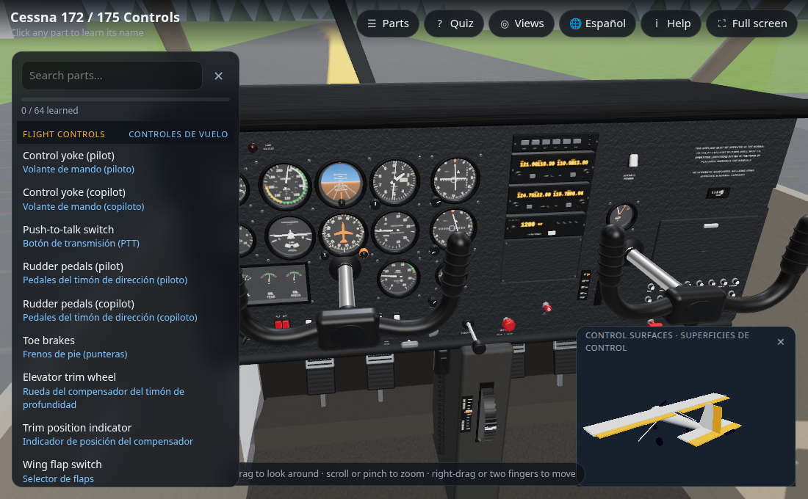

# cessna-controls

An interactive, full-screen 3D cockpit for learning the controls of a Cessna 172 / 175 style
light airplane. Click any control or instrument to see its name in **English and Spanish**,
what it does, and a short demonstration of how it moves.

**Live site:** https://lastmjs.github.io/cessna-controls/



## Features

- 64 selectable parts: flight controls, engine controls, fuel, electrical and lights, flight and engine instruments, radios, and cabin items
- Every part named in English and Spanish, with a short explanation in both languages
- "Show me" demonstrations: the yoke turns and pulls, flaps step down, the key turns through the magneto check, the fuel selector rotates, and the gauges react (RPM, ammeter, suction, low-voltage light)
- A small airplane that shows what the yoke, rudder pedals, trim and flaps move
- Quiz mode, progress tracking and settings saved in local storage
- Full-screen mode, keyboard shortcuts, touch support

Everything is built from code in the browser with [three.js](https://threejs.org/). There are
no downloaded 3D models or photos. Your progress (parts you have marked as learned, quiz best
score, settings) is saved in your browser's local storage and never leaves your device.

## Run locally

It is a static site with no build step:

```bash
python3 -m http.server 8000
```

Then open http://localhost:8000.

## Legal

This is an independent educational project. It is not affiliated with, endorsed by, or
sponsored by Textron Aviation Inc. "Cessna" is a trademark of Textron Aviation Inc. and is used
here only to describe the aircraft type the cockpit represents. See [LEGAL.md](LEGAL.md).

This is not a flight training device and does not replace your airplane's Pilot's Operating
Handbook (POH), an instructor, or approved training.

## License

MIT. See [LICENSE](LICENSE).
